# ZeroWaste Grocer — Comprehensive User Flow & Architecture Reference

This document provides the authoritative, end-to-end specification of user workflows, role-based access controls, data lifecycles, and user interactions across the ZeroWaste Grocer enterprise platform.

---

## 1. Actors & Permissions Matrix

The ZeroWaste Grocer platform enforces strict Role-Based Access Control (RBAC) symmetrically across both the Flutter client and the FastAPI backend.

| Actor Role | Screen / Feature | Allowed Actions | Client Enforcement (Flutter) | Backend Enforcement (FastAPI) |
| :--- | :--- | :--- | :--- | :--- |
| **Store Manager** | **Dashboard** (`/dashboard`) | View KPIs, Projected Waste Exposure, Units at Risk, Waste Trend Chart | `scaffold_with_nav_bar.dart:243` | `endpoints/analytics.py:28` (`get_current_user`) |
| | **Catalog** (`/catalog`) | Browse products, filter by category, sort by shelf-life, view batch breakdown bottom sheet | `scaffold_with_nav_bar.dart:257` | `endpoints/inventory.py:24` |
| | **Reorder** (`/reorder`) | View ML replenishment recommendations, expand XAI drivers, Approve single/all, Override quantities & reasons | `scaffold_with_nav_bar.dart:261` | `endpoints/replenishment.py:35` (`require_role("storeManager")`) |
| | **Alerts** (`/alerts`) | View spoilage alerts, Accept Markdown (-XX%), Dismiss alerts | `scaffold_with_nav_bar.dart:262` | `endpoints/alerts.py:42` (`require_role("storeManager")`) |
| | **Analytics** (`/analytics`) | View Sales vs Predictions, Waste Risk Exposure, Category Waste breakdown | `scaffold_with_nav_bar.dart:267` | `endpoints/analytics.py:45` |
| **Inventory Auditor** | **Catalog** (`/catalog`) | Browse inventory stock, inspect batches, perform daily closing stock audit | `app_router.dart:58` (Redirects to `/catalog`) | `endpoints/inventory.py:85` |
| | **Audit Dialog** | Input verified physical stock count, select shrinkage reason, submit audit | `catalog_screen.dart:294` (`FloatingActionButton`) | `endpoints/inventory.py:112` (`require_role("inventoryAuditor")`) |
| | **Reorder / Alerts / Dash** | **BLOCKED**: Navigation bar restricted to Catalog tab only; Reorder tab displays "Access Restricted" shield | `reorder_screen.dart:98`, `scaffold_with_nav_bar.dart:218` | `endpoints/replenishment.py:36` (Returns `403 Forbidden`) |
| **System Admin** | **Dashboard** (`/dashboard`) | Multi-store oversight, select store from dropdown, monitor enterprise KPIs | `scaffold_with_nav_bar.dart:109` (`DropdownButton`) | `endpoints/stores.py:20` (`require_role("systemAdmin")`) |
| | **Catalog** (`/catalog`) | Inspect stock across all stores, view batch lifecycles | `scaffold_with_nav_bar.dart:257` | `endpoints/inventory.py:24` |
| | **Alerts** (`/alerts`) | Read-only oversight of active alerts (action buttons hidden) | `alert_card.dart:284` (`canApplyMarkdown = false`) | `endpoints/alerts.py:65` (Read allowed, write blocked) |
| | **Analytics** (`/analytics`) | View enterprise-wide predictive accuracy and waste trends | `scaffold_with_nav_bar.dart:267` | `endpoints/analytics.py:45` |
| | **Reorder** (`/reorder`) | **BLOCKED**: Reorder tab hidden from Admin navigation bar | `scaffold_with_nav_bar.dart:250` | `endpoints/replenishment.py:36` (Returns `403 Forbidden`) |

---

## 2. App Entry & Authentication Workflow

### 2.1 Login Portal
- **Route**: `/login` ([`login_screen.dart`](file:///F:/Development/Projects/Mobile-Apps/app_Mena/lib/features/auth/presentation/screens/login_screen.dart))
- **Form State**: Text fields initialize completely blank (`TextEditingController()`). No mock chips or auto-fill credentials appear on screen.
- **Validation**: Email requires non-empty standard email format; password requires minimum 6 characters.
- **API Call**: `POST /api/v1/auth/login` (`application/x-www-form-urlencoded` or JSON payload).
- **Session Tokens**: Access token stored in memory via Riverpod [`currentUserProvider`](file:///F:/Development/Projects/Mobile-Apps/app_Mena/lib/features/auth/presentation/auth_providers.dart).
- **Navigation Redirection**:
  - `UserRole.storeManager` & `UserRole.systemAdmin` $\rightarrow$ `/dashboard`
  - `UserRole.inventoryAuditor` $\rightarrow$ `/catalog` (direct landing; other routes guarded)

---

## 3. End-to-End Workflows with Architectural Diagrams

### Flow 1: Spoilage Alerts & Markdown Execution
When batches approach expiry within the critical window ($\le 3$ days), the ML markdown engine computes optimal discounts (10% to 50%) to maximize revenue while preventing landfill spoilage.

#### Flowchart
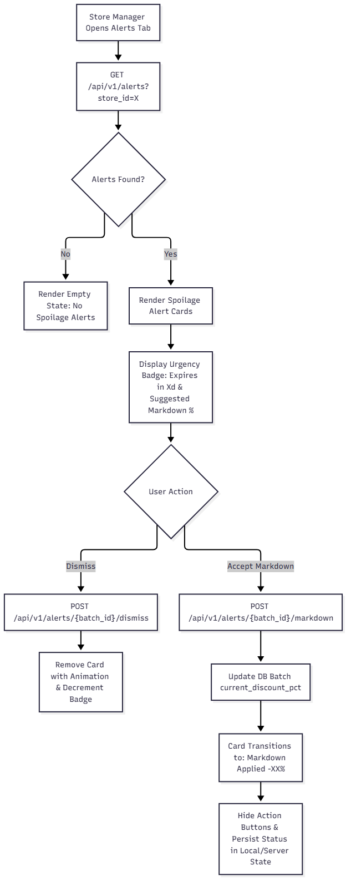

#### Sequence Diagram
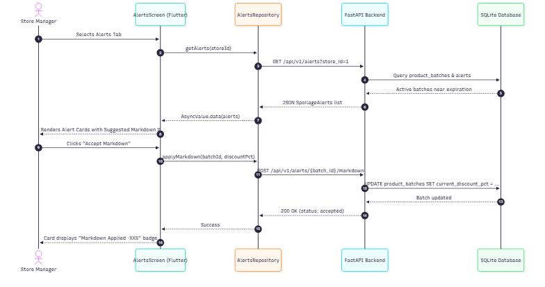

#### Step-by-Step Execution:
1. **Alert Retrieval**: Manager navigates to Alerts tab. `GET /api/v1/alerts?store_id=1` returns active spoilage items.
2. **Urgency Categorization**:
   - $\le 1$ day remaining: Red alert badge (`Expires in 1d` or `Expired`).
   - $\le 3$ days remaining: Orange warning badge (`Expires in 2d` / `Expires in 3d`).
   - $> 3$ days: Green safe badge.
3. **Discount Recommendation**: Model indicates recommended markdown (e.g. *Suggested: Apply 20% discount to clear surplus*).
4. **Action Choice**:
   - **Accept Markdown**: Sends `POST /api/v1/alerts/{batch_id}/markdown` with suggested percentage. Backend updates `product_batches.current_discount_pct` in SQLite. Card immediately updates to green status banner: `Markdown Applied −XX%`. Action buttons disappear.
   - **Dismiss**: Sends `POST /api/v1/alerts/{batch_id}/dismiss`. Alert marked dismissed; card smoothly leaves the active view.

---

### Flow 2: Replenishment Reorder Recommendations & Purchase Approvals
LightGBM quantile regression forecasts customer demand 7 days ahead. Reorder quantities are computed considering current stock, safety stock, and supplier delivery lag.

#### Flowchart
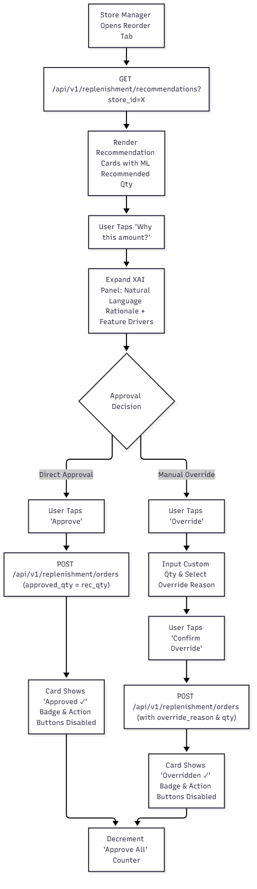

#### Sequence Diagram
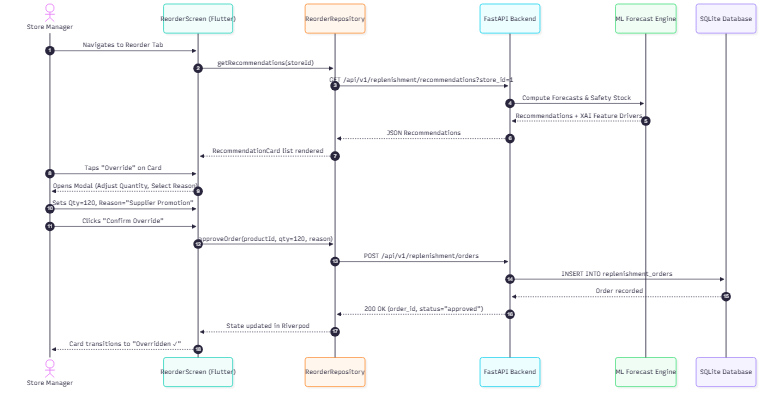

#### Step-by-Step Execution:
1. **Recommendation Query**: Manager selects Reorder tab. `GET /api/v1/replenishment/recommendations?store_id=1` is called without arbitrary client dates, letting backend anchor to `effective_today`.
2. **XAI Expansion**: Manager taps *"Why this amount?"*. Panel smoothly unfolds displaying:
   - Natural language narrative (e.g., *"Demand spike anticipated due to weekend trend and upcoming promotion"*).
   - Horizontal progress bars showing top impact features (e.g., `Lag_7_Sales: +42%`, `Safety_Stock_Buffer: +28%`).
3. **Approve Workflow**:
   - **One-Click Approval**: Tapping **Approve** issues `POST /api/v1/replenishment/orders`. Card displays permanent `Approved ✓` badge. The top bar counter *Approve All (X)* decrements.
   - **Manual Override**: Tapping **Override** opens dialog. Manager adjusts numerical stepper, chooses mandatory reason (*Supplier Promotion*, *Anticipated Surge*, *Storage Constraint*), and taps **Confirm**. Card updates to `Overridden ✓`.

---

### Flow 3: Daily Closing Inventory Stock Audit
Ensures physical store inventory matches system records and tracks shrink/waste variances.

#### Flowchart
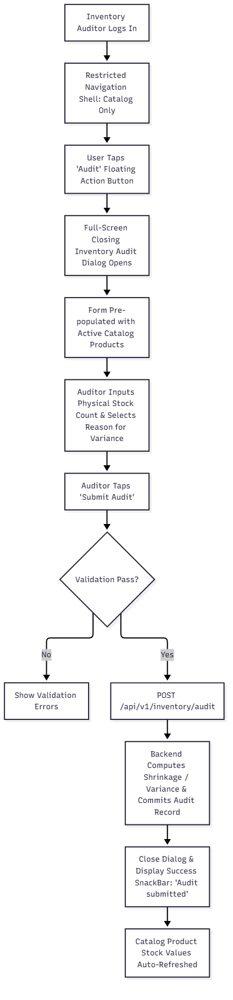

#### Sequence Diagram
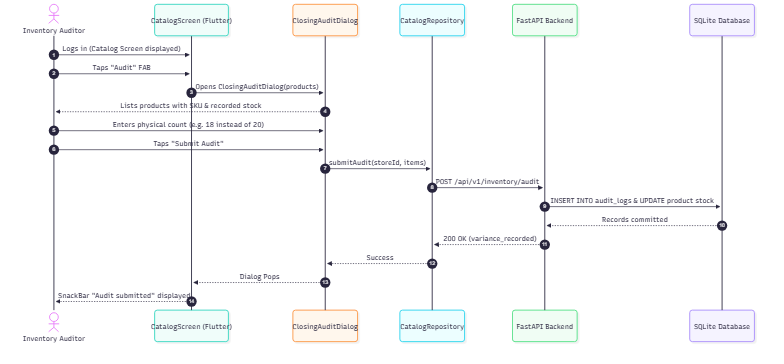

#### Step-by-Step Execution:
1. **Auditor Entry**: Auditor logs in and lands directly on Catalog screen. Bottom navigation bar shows only the Catalog tab.
2. **Initiate Audit**: Auditor taps the prominent bottom-right **Audit** Floating Action Button.
3. **Audit Dialog**: Full-screen dialog loads active products with SKU and system-recorded stock.
4. **Count Verification**: Auditor enters counted units. If count differs from system, variance reasons are provided.
5. **Submission**: Tapping **Submit Audit** issues `POST /api/v1/inventory/audit`. Backend commits audit log, updates stock quantities, pops dialog, and triggers a confirmation SnackBar.

---

### Flow 4: Background Notifications Polling & Badge Lifecycle
Provides real-time notifications for newly triggered spoilage alerts without interrupting store floor operations.

#### Flowchart
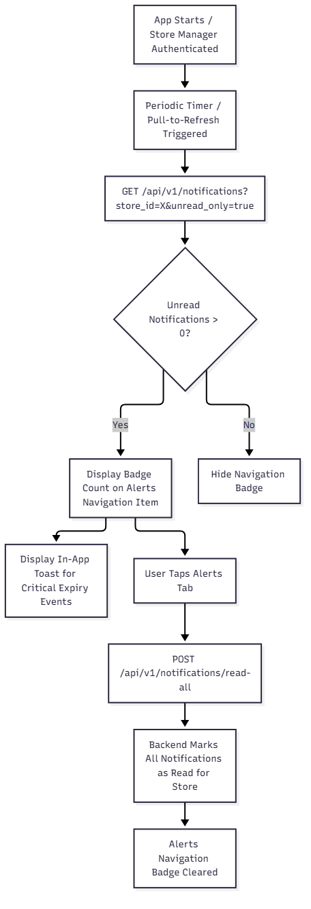

#### Sequence Diagram
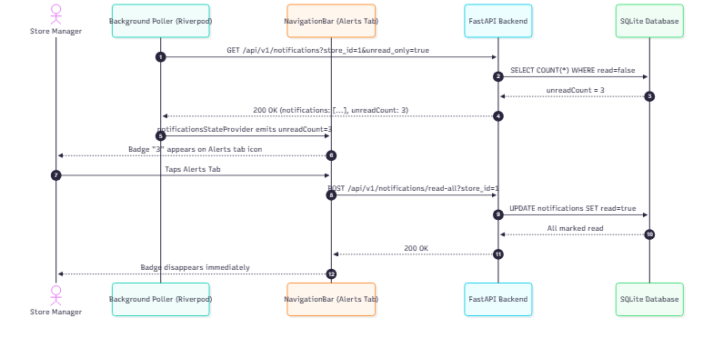

#### Step-by-Step Execution:
1. **Polling Cycle**: Client periodically polls `GET /api/v1/notifications?store_id=1&unread_only=true`.
2. **Badge Display**: If `unread_count > 0`, red badge showing number (e.g. `3`) appears over the Alerts bottom navigation icon.
3. **Auto Mark-As-Read**: When Store Manager taps the Alerts tab, client sends `POST /api/v1/notifications/read-all`. Backend marks notifications as read; navigation badge is cleared immediately.

---

### Flow 5: Theme Toggle (Light/Dark Mode) & Hive Box Persistence
Ensures high-contrast accessibility under varying retail store lighting conditions (bright daylight vs night stocking).

#### Flowchart
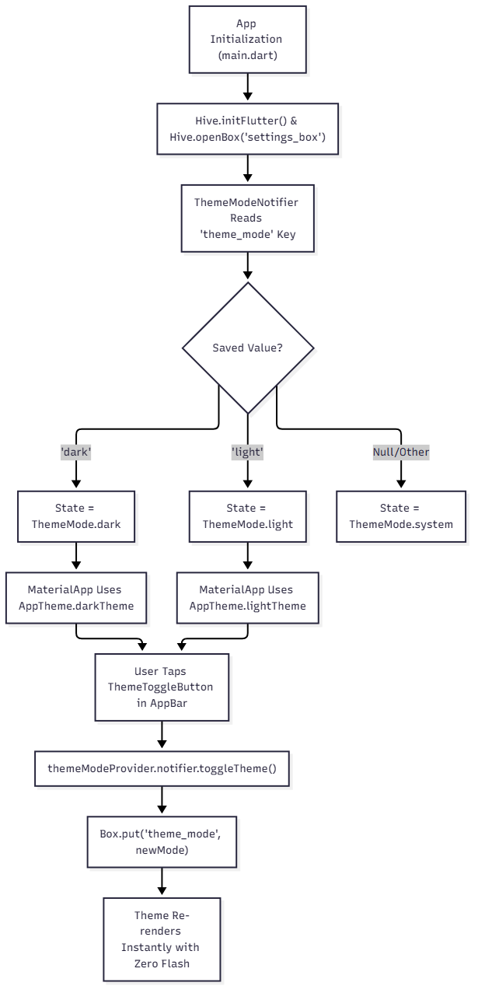

#### Sequence Diagram
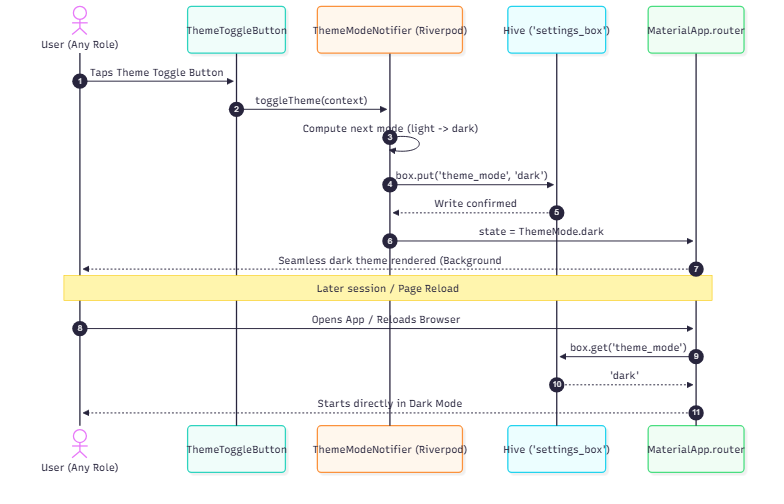

#### Step-by-Step Execution:
1. **Initialization**: On application boot (`main.dart`), Hive initializes and opens box `'settings_box'`.
2. **State Hydration**: Riverpod `ThemeModeNotifier` reads key `'theme_mode'` (`'dark'`, `'light'`, or default `'system'`).
3. **Dynamic Toggle**: Tapping `ThemeToggleButton` in the AppBar toggles the state between dark and light.
4. **Instant Persistence**: The new mode is written to `'settings_box'`. Future app boots and browser reloads restore user preference with zero screen flash.
5. **WCAG 2.1 AA Compliance**: Dark surface (`#1E1E1E`), dark background (`#121212`), high-contrast text ratios ($\ge 14.8:1$), and chart series ($\ge 5.3:1$) pass accessibility standards.

---

## 4. Operational Matrices

### 4.1 Data Refresh Matrix

| Feature | Refresh Triggers | Client Mechanism | Backend Endpoint |
| :--- | :--- | :--- | :--- |
| **KPIs & Metrics** | App launch, Pull-to-refresh, Store switch | `ref.refresh(dashboardMetricsProvider)` | `GET /api/v1/analytics/waste-metrics` |
| **Catalog & Batches** | Pull-to-refresh, Audit completion, Category filter | `ref.refresh(productsProvider)` | `GET /api/v1/stores/{id}/inventory` |
| **Reorder List** | Store switch, Order approval | `ref.refresh(recommendationsProvider)` | `GET /api/v1/replenishment/recommendations` |
| **Spoilage Alerts** | Notification trigger, Pull-to-refresh, Markdown accept | `ref.refresh(alertsProvider)` | `GET /api/v1/alerts` |
| **Notifications** | Periodic timer (30s), Tab switch | `ref.read(notificationsProvider.notifier).poll()` | `GET /api/v1/notifications` |

### 4.2 Error & Empty State Matrix

| Context | State Type | Visual Display | Recovery Action |
| :--- | :--- | :--- | :--- |
| **Network Unavailable** | Error | Full-screen offline icon, descriptive error message, primary "Retry" button | Tapping Retry re-triggers provider future |
| **401 Unauthorized** | Error | Floating red SnackBar "Session expired", auto-redirect to `/login` | User re-enters credentials |
| **Zero Spoilage Alerts** | Empty State | Shield icon, "No spoilage alerts — All batches within safe expiration windows" | Automatic on next alert trigger |
| **Zero Recommendations** | Empty State | Cart check icon, "All products sufficiently stocked for current forecast window" | Re-evaluates next demand cycle |
| **Catalog Search Miss** | Empty State | Search lens icon, "No products found matching query", clear search button | Tap "Clear Filter" restores full catalog |

---

## 5. UI Screen Reference Gallery

| Screen | Light Mode Reference | Dark Mode Reference |
| :--- | :--- | :--- |
| **Login Portal** | 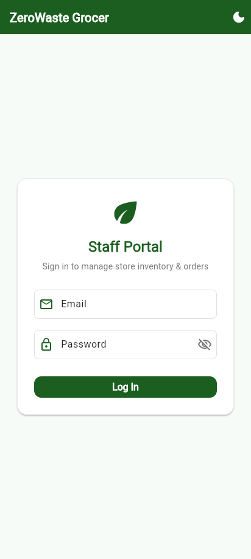 | 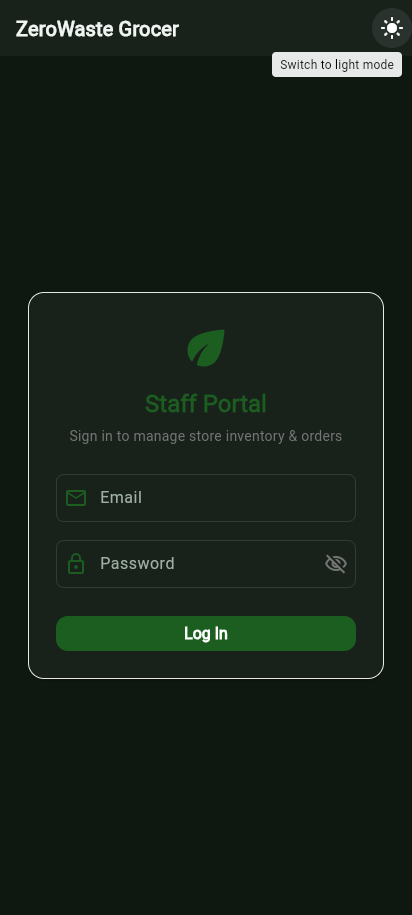 |
| **Store Dashboard** | 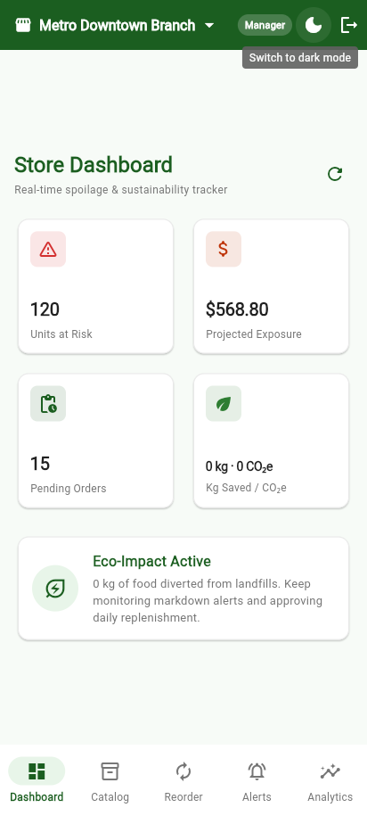 | 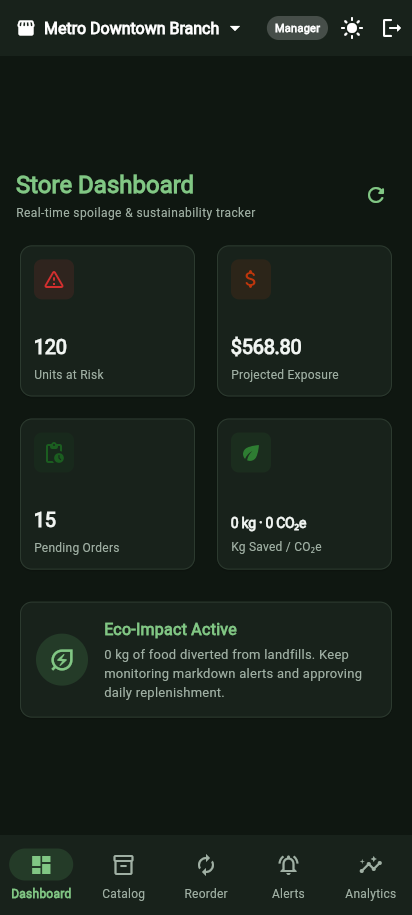 |
| **Catalog & Batches** | 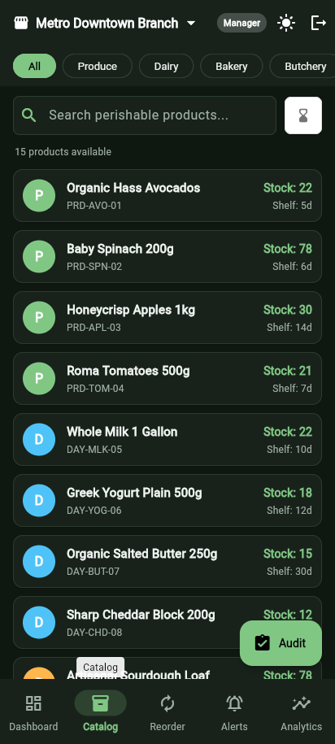 | 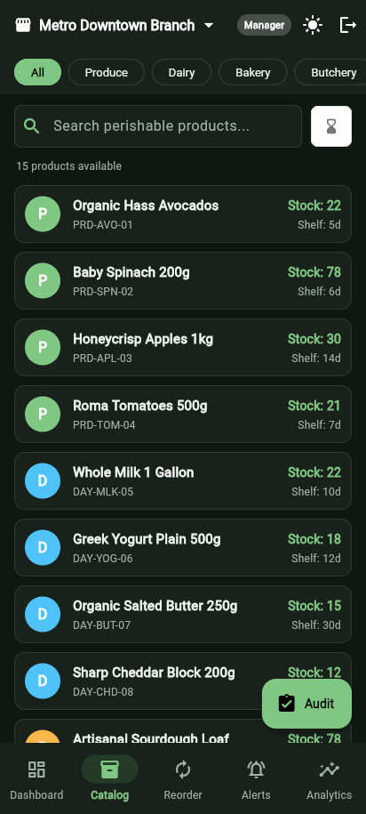 |
| **Reorder Recommendations** | 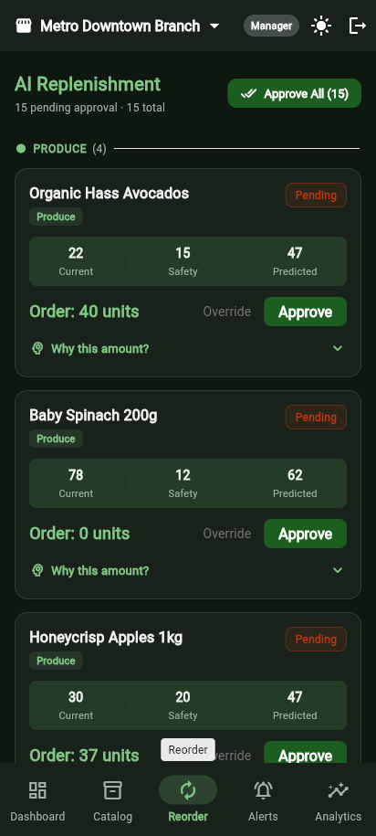 | 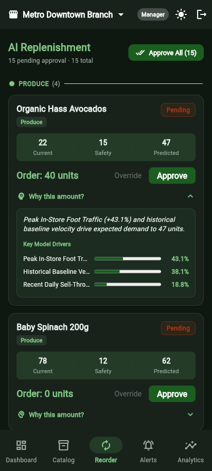 |
| **Spoilage Alerts** | — | 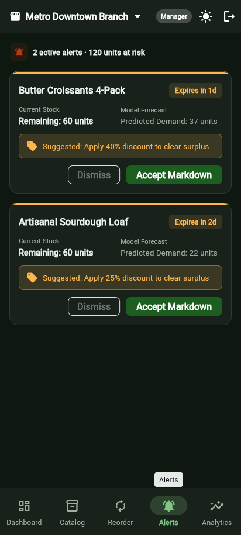 |
| **Predictive Analytics** | — | 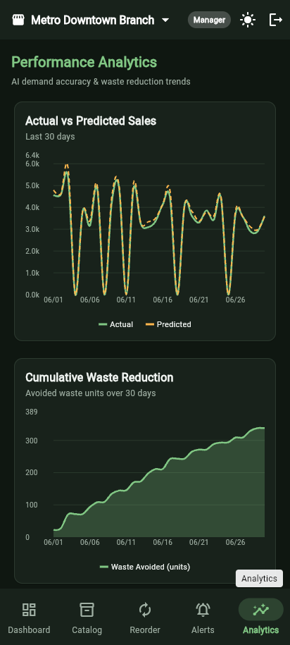 |
| **Inventory Auditor Catalog** | — | 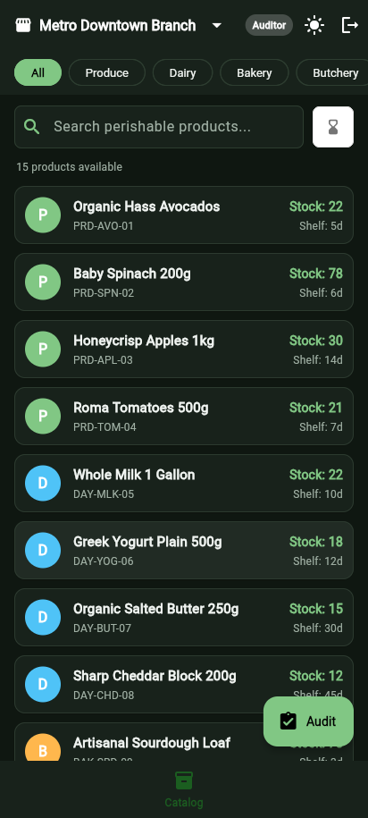 |
| **Closing Stock Audit Dialog** | — | 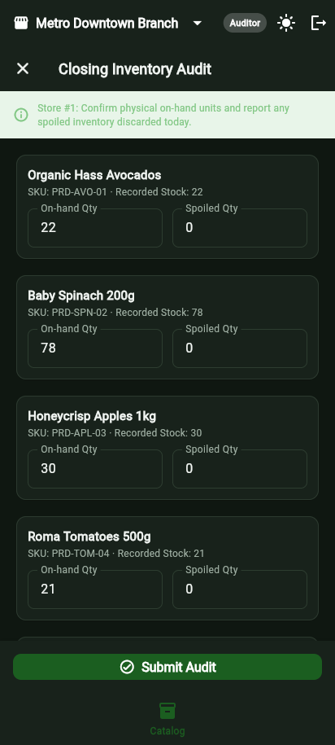 |
| **Admin Store Selector** | — | 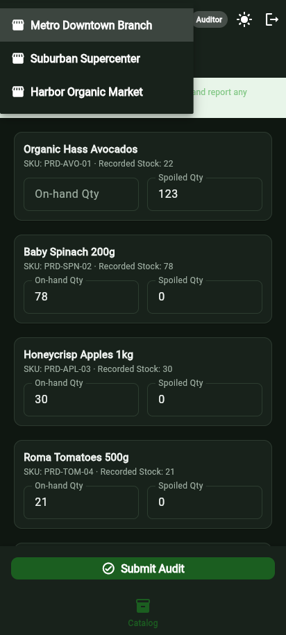 |

---
*Documentation compiled and verified against ZeroWaste Grocer production codebase.*
